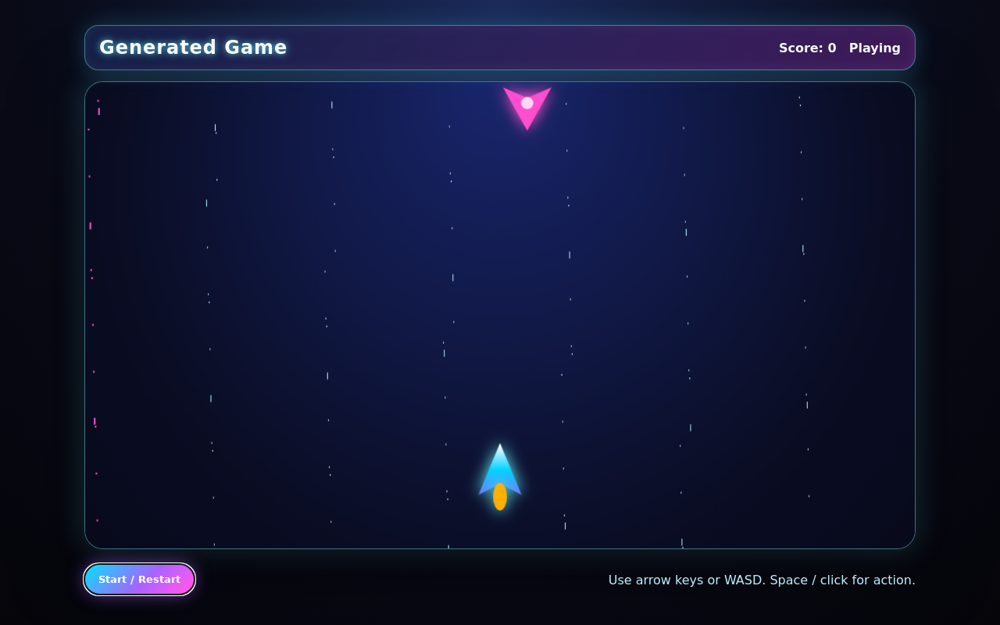

# GameGen · OpenCode

**把游戏想法转成可玩的浏览器项目，并通过构建、浏览器测试和用户反馈继续迭代。**

[English](README.md) · [命令说明](docs/CLI.md) · [架构](docs/ARCHITECTURE.md) · [GitHub 发布步骤](docs/PUBLISH_TO_GITHUB.md)



这是一个本地运行的 AI 游戏生成 CLI。它通过 OpenCode 调用不同角色的 Agent，产出 Vite + TypeScript + Canvas 项目，支持文字、图片和视频帧参考。

当前版本：`0.10.3`，基于原始 `v10.2` 整理。截图展示的是随仓库提供的基础游戏模板，不代表已经验证付费模型生成效果。

## 无需 API key 的演示

需要 Node.js **22.12 或更高版本**、npm 和 Git。在仓库根目录运行：

```bash
npm ci
npm run demo
npm run preview
```

打开 **http://127.0.0.1:5173**。点击 Start，方向键/WASD 移动，空格或鼠标点击射击。

`demo` 复制内置模板、安装锁定依赖并生成本地 SVG 素材，不调用 AI。项目保存在 `generated/job_<时间戳>/project`，不会提交到 Git。

如需浏览器测试：

```bash
npx --no-install playwright install chromium
npm run qa
```

Linux 缺少浏览器系统依赖时，使用 `npx --no-install playwright install --with-deps chromium`。

## 使用 AI 生成

先安装 OpenCode，配置自己的模型账户：

```bash
npm install -g opencode-ai
cp .env.example .env
opencode auth login
opencode models --refresh
```

核对 `config/model-profiles.json` 的模型名称。预设保留原项目的配置方式，模型是否可用、是否付费，以你当前账户和服务商文档为准。

```bash
node bin/gamegen.mjs render-config
node bin/gamegen.mjs auth-check
node bin/gamegen.mjs create "Make a neon shooter with score and restart" --type shooter
node bin/gamegen.mjs preview
```

编码模型通过 OpenCode 登录。只有显式使用 `--use-openai-images` 时，图片生成流程才调用 OpenAI；其 key 放在本地 `.env` 或环境变量中。默认使用 SVG 素材。

视频参考需要 FFmpeg；导出源码需要 `zip`。支持 macOS/Linux；Windows 推荐 WSL2。也可以运行 `./install-gamegen.sh` 完成本项目的本地依赖安装。

## 已实现功能

- 从自然语言创建、预览和导出游戏项目。
- 图片、视频及角色标签参考输入。
- 规划、编码、素材、QA 与视觉优化的 Agent 角色配置。
- 构建、Playwright 浏览器测试、运行错误与素材文件检查。
- 失败后在指定轮数内修复；根据反馈改善已生成项目。
- 多任务管理；使用 `--job` 或 `--project` 选择项目。

视觉分数和反馈验收是启发式检查，不保证游戏质量。当前只有一个基础模板；`--type` 用于指导提示词，尚未实现各游戏类型的专用模板。

## 开发和发布

```bash
npm test
npm run check
python3 scripts/check_release.py
```

仓库附带 MIT 许可证、锁定依赖、GitHub Actions、Issue/PR 模板及[发布说明](docs/PUBLISH_TO_GITHUB.md)。公开代码不包含实际 key、用户上传、生成任务或依赖目录。

作者：**Ziyang Ye**。原始源码采用 [MIT](LICENSE)，外部依赖和服务分别遵循其自身条款。
